<p align="center">
  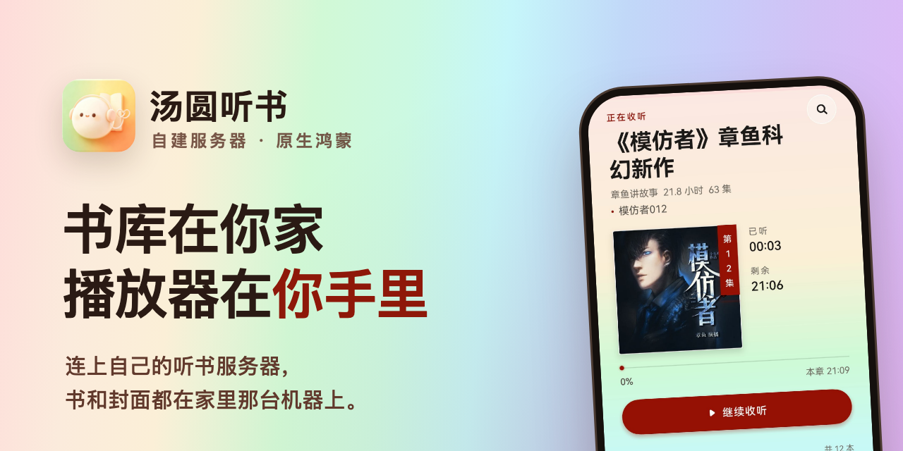
</p>

<h1 align="center">汤圆听书</h1>

<p align="center">
  为 HarmonyOS 写的 <a href="https://www.audiobookshelf.org/">Audiobookshelf</a> 原生客户端。<br>
  连上你自己搭的服务器，书、封面、播放记录都在你自己的机器上。
</p>

<p align="center">
  <code>HarmonyOS 6.1+</code> · <code>API 23 起</code> · <code>ArkTS / ArkUI</code> · <code>Stage 模型</code>
</p>

> 本仓库**只分发安装包与更新日志**，不提供源码。

<div align="center">
  <b>请我喝杯咖啡</b><br>
  <sub>全部功能免费，没有广告也没有会员。打赏完全自愿，不换取任何功能或权益；不打赏也能使用全部功能。</sub>
  <br><br>
  &nbsp;&nbsp;&nbsp;&nbsp;&nbsp;&nbsp;
  <br>
  <sub>微信（左） · 支付宝（右）</sub>
</div>

---

## 重要声明

- 汤圆听书是一款**非官方的第三方客户端**，用于连接你自己搭建的
  [Audiobookshelf](https://www.audiobookshelf.org/) 服务端。
  **本软件不提供、不分发、不托管任何音频内容**；书籍与音频全部来自你自己的服务端。

- 本软件与 Audiobookshelf 项目及其开发者**无任何隶属、授权、合作或其他关联关系**，
  不代表该项目。「Audiobookshelf」名称及相关标识的权利归其权利人所有。

- 本软件**不旨在替代官方客户端**。它只是把你自己服务端里的书，
  用鸿蒙原生的方式播放出来。

- 应用**全功能免费，无内购、无广告**。设置页有一个「请开发者喝杯咖啡」的自愿打赏入口，
  **不换取任何功能或权益**，不打赏也能使用全部功能。

---

## 安装包

每个版本提供两个文件，**都是未签名的**：

| 资产 | 是什么 | 谁能直接用 |
| --- | --- | --- |
| `TangyuanAudio-<版本>-unsigned.hap` | 单模块 HAP 安装包 | 需要先签名，或用会自动重签的安装器 |
| `TangyuanAudio-<版本>-unsigned.app.zip` | App Pack，**解压得到 `.app`**（内含同结构的 hap） | 同上；主要用于自行重新打包/签名 |

> `.app` 之所以打成 zip：GitHub 的 Release 资产不接受 `.app` 这个扩展名，
> 只能压缩后再上传。里面只有一个文件，解开就是 `.app` 本身。

**两个包都没有签名，不能直接安装**，用之前需要签一次（或让安装器代签）。
不用签名就能装的方式见下节。

**不随 Release 发布：** `*-signed.hap`、`*-signed.app`，以及任何
`.p12` / `.cer` / `.p7b` 证书材料。

---

## 怎么安装

### 方式一：加入华为应用商店邀测（最省事，不用签名）

在**鸿蒙手机的系统浏览器**里打开下面这个链接 → 点「开始测试」→ 跳到应用市场安装：

**[汤圆听书 · 加入邀测](https://appgallery.huawei.com/link/invite-test-wap?taskId=45b0099de47a4fd04c4a71693d8184fb)**

- 必须用 **HarmonyOS NEXT 系统浏览器**打开；微信 / QQ / 其他 App 的内置浏览器会提示
  「请使用 HarmonyOS NEXT 系统浏览器打开」。
- 页面上会显示当前邀测包的版本号。**商店里的版本可能落后于本仓库的 Release**，
  想第一时间用上新改动，就用下面的未签名包。
- 如果提示「该版本发布范围未包含当前设备」，说明这台设备不在测试覆盖范围内，
  同样走下面的未签名包。

### 方式二：用会自动重签的安装器

先把安装器装进手机，之后本项目的 HAP 在手机端一键安装，不用自己写命令。

**第 1 步：手机准备**

设置 → 关于手机，连点「版本号」开启**开发者模式**；
再进「系统和更新 → 开发人员选项」打开 **USB 调试**。

**第 2 步：找一台「宿主」设备把安装器推进去**

| 你的情况 | 用什么 |
| --- | --- |
| 有 Windows / macOS 电脑 | [auto-installer Releases](https://github.com/likuai2010/auto-installer/releases)（小白调试助手） |
| 只有一台安卓手机 | 同上仓库里的 Android 版 APK，用 **OTG 线**直连鸿蒙手机当调试主机 |
| 想要图形化重签名 / 投屏 | [HoKit Releases](https://github.com/yabi-zzh/HoKit/releases) |

> ⚠️ 上面这些都是**第三方工具，与本项目无关**，我没有参与开发也没有审计过。
> 用不用、用哪个版本，请你自己判断并承担风险。项目本身不需要这些工具也能安装（见方式三）。

**第 3 步：手机端装汤圆听书**

1. 打开安装器；
2. 从本仓库 Release 下载 `TangyuanAudio-<版本>-unsigned.hap`；
3. 选中这个 HAP，点安装。之后每次更新版本同样操作。

> 鸿蒙不允许第三方 HAP 直接在手机里侧载，所以「把安装器装进手机」这一步绕不开；
> 装好之后，后续所有 HAP 都能在手机上自助安装。

### 方式三：自己签名（不需要任何第三方工具）

未签名包要能装上，**签名用的 Profile 里 bundle-name 必须等于 `com.sunny.tangyuanaudio`**。
这是最容易漏的一步：拿一个别的工程签出来的 Profile 是装不上的。

1. 装 **DevEco Studio**，登录华为开发者账号。
2. 新建一个空工程，把 `AppScope/app.json5` 里的 `bundleName` 改成
   **`com.sunny.tangyuanaudio`**（必须一字不差）。
3. `File > Project Structure > Signing Configs`，勾选 **Automatically generate signature**，
   等它生成 `xxx.p12 / xxx.cer / xxx.p7b`（会自动带上你账号下已登记的设备 UDID）。
4. 用 DevEco 自带的 `hap-sign-tool.jar` 给下载的 HAP 签名：

```bash
java -jar hap-sign-tool.jar sign-app \
  -mode localSign -keyAlias "<你的别名>" \
  -keyPwd "<密码>" -keystorePwd "<密码>" \
  -appCertFile "<xxx.cer>" -profileFile "<xxx.p7b>" -profileSigned 1 \
  -inFile TangyuanAudio-<版本>-unsigned.hap -outFile entry-signed.hap \
  -signAlg SHA256withECDSA -keystoreFile "<xxx.p12>"

hdc install entry-signed.hap
```

> 调试证书只在你账号下**登记过 UDID 的设备**上有效。想装到别的手机，
> 要先把那台手机的 UDID 加进调试证书（DevEco 里重新自动签名一次即可）。
> 只签 hap 就有用；`.app` 给需要对整个 App Pack 重新签名 / 重新打包的人。

---

## 截图

### 商店图

| | | |
| --- | --- | --- |
| 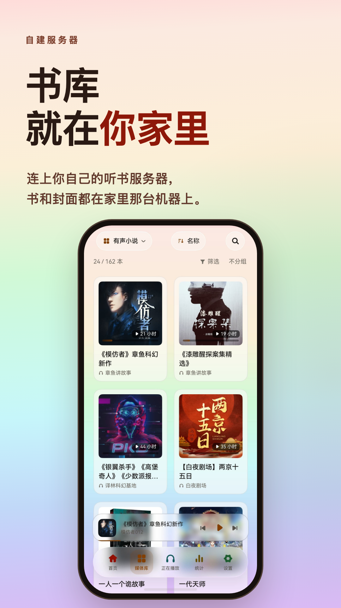 | 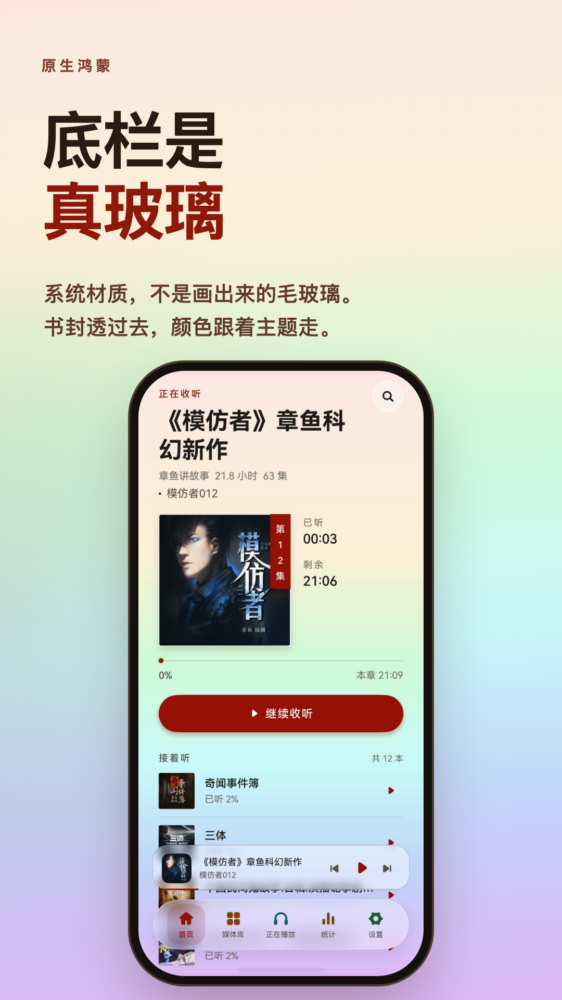 | 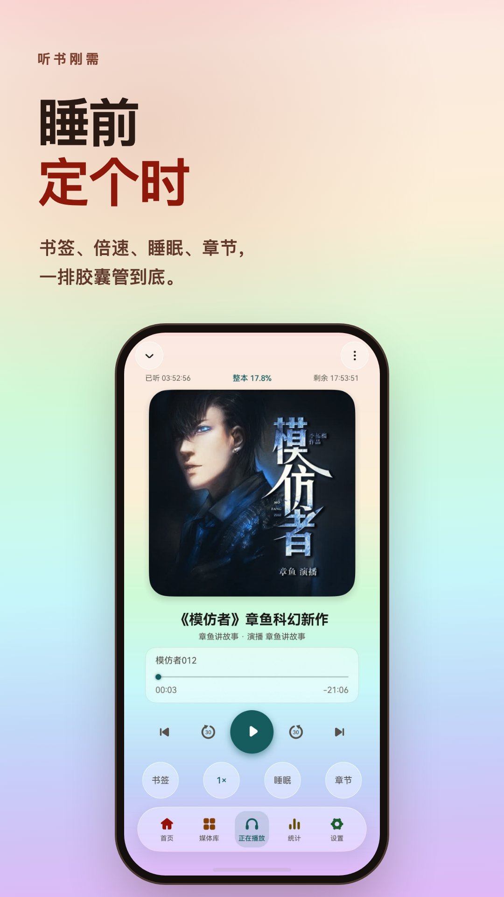 |
| 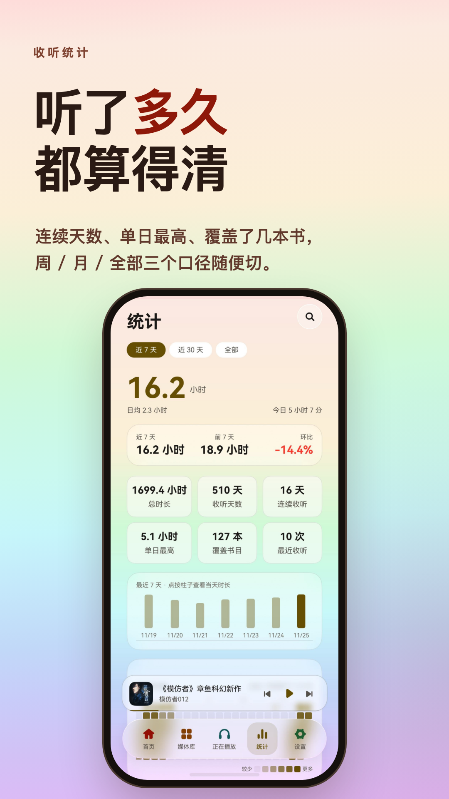 | 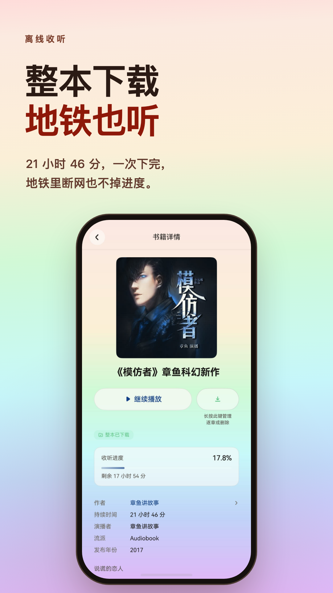 | 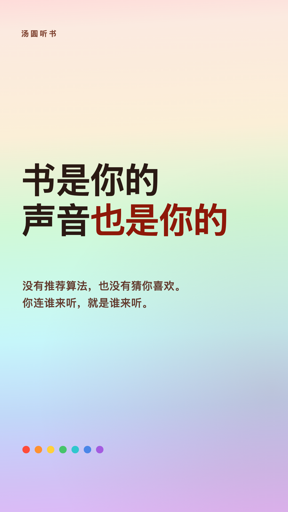 |

### 界面原图

| 首页（浅色） | 首页（深色） | 正在播放 |
| --- | --- | --- |
| 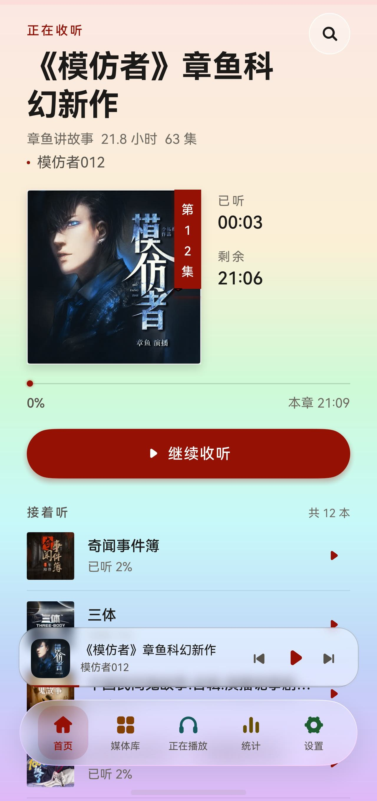 | 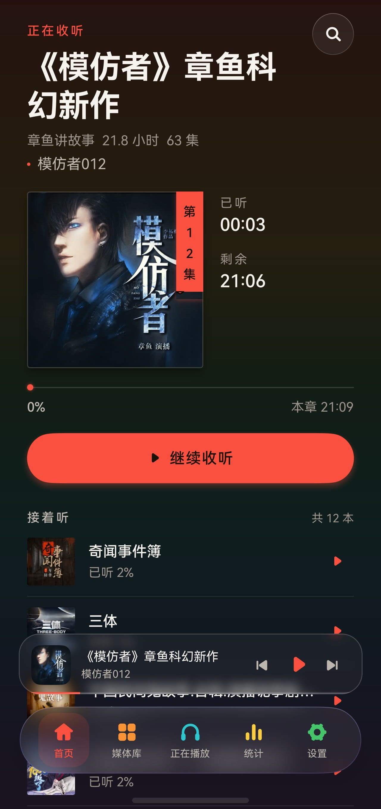 | 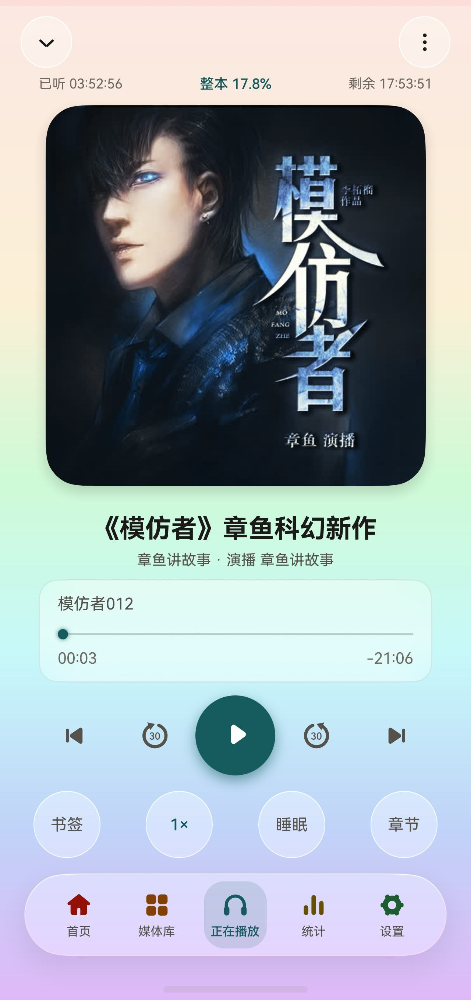 |

| 媒体库 | 统计 | 书籍详情 |
| --- | --- | --- |
| 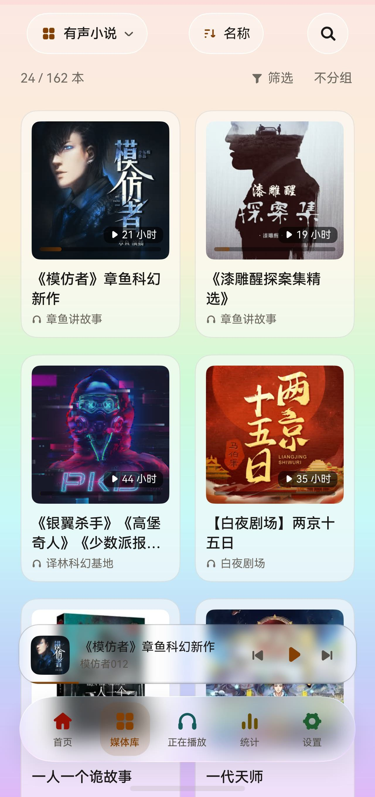 | 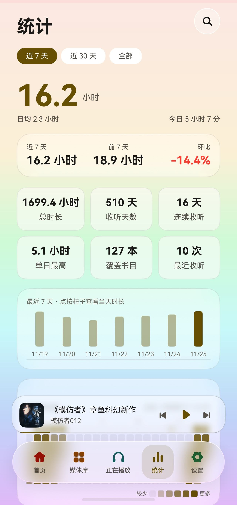 | 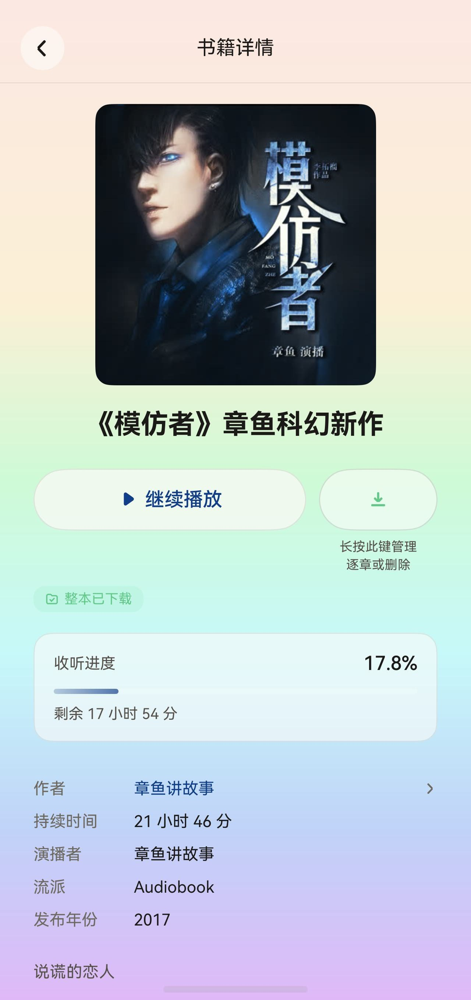 |

---

## 需要准备什么

汤圆听书本身**不提供内容**。要用它，你需要：

1. 一台运行 [Audiobookshelf](https://www.audiobookshelf.org/) 的服务器
   （NAS、树莓派、旧笔记本、云主机都行）
2. 自己的有声书文件
3. 手机和服务器在同一个网络（或服务器可从公网访问）

首次启动后填服务器地址 → 登录你的 Audiobookshelf 账号即可。

> 没有服务器也能试：应用内提供**演示模式**，内置 10 本演示书目，
> 封面由程序生成、音频是占位提示音，不需要任何服务端就能完整走一遍
> 播放、章节、进度、书签、统计。

---

## 功能

### 播放
- 章节进度与整本进度分离：整本信息在封面上方一行读完，本章进度是一条可拖动的沉浸玻璃胶囊
- 倍速（0.5×–3×）、快进快退步长、自动连播下一章
- **睡眠定时**：到本章结束 / 15 / 30 / 45 / 60 / 90 分钟；摇一摇重置，暂停时同步暂停
- 书签（可同步服务端）、章节列表、音轨列表
- 移动数据流式播放策略：总是 / 仅 Wi-Fi / 禁止
- 后台播放、耳机按键、通知栏控制

### 媒体库
- 多库切换、搜索历史、封面进度轨、离线下载
- **筛选**：按进度 / 作者 / 演播 / 流派 / 标签，选一个立刻生效
- **排序**：最近播放 / 名称 / 演播者 / 时长 / 最近添加
- 书籍详情：整本进度、章节、音轨、简介、系列、下载管理
- **作者页**：作者的全部作品一屏读完，带总时长与系列信息

### 统计
- 近 7 天 / 近 30 天 / 全部时间三种口径
- 7 天柱图可点选某一天查看准确时长，30 天趋势可点格查看
- 听得最多的书、最爱演播、类型偏好、最近收听
- 榜单每一行都能点：书进详情，演播 / 分类带关键词进搜索页

### 外观
- **主题**：赤 / 橙 / 黄 / 绿 / 青 / 蓝 / 紫 七色，外加把七种颜色全用上的「葫芦娃」，
  共 **8 套**；默认是**浅色 + 葫芦娃**
- **外观模式**：浅色 / 深色 / 跟随系统，切换即时生效
- **字重**：100–700 连续滑杆（细 ↔ 粗），只用系统字体，不打包第三方字库
- **沉浸光感**：官方 ImmersiveMaterial 材质，主题色派生整屏氛围色。
  组件级材质是 API 26 能力：26+ 走真材质，23/24 自动降级为官方模糊；
  底栏的 HDS 玻璃两代系统都能用
- 底部胶囊 TabBar、迷你播放条（可关闭）、悬浮搜索键

### 离线
- 下载策略：总是 / 仅 Wi-Fi / 禁止；整本播完自动删除
- **整本一键下载**：详情页点下载键即下整本，长按可逐章选择
- 流缓存上限（256 MB ~ 4 GB / 关闭）与一键清空，不影响已下载的书
- 下载管理页可逐本 / 逐章删除，进度、速度、占用一目了然

### 账号与连接
- 多服务器、多账号保存与切换
- **两步连接**：先验证服务器，再登录账号；连不上时告诉你卡在哪一步
- 服务器列表带健康状态（在线 / 需重新登录 / 连不上）
- 进度与书签双向同步，断线自动重连；两者也可以单独关闭
- 服务器地址与设置保存在本机，访问令牌保存在系统安全存储（Asset Store），
  旧版本遗留的明文凭据会在启动时自动迁移；不上传任何第三方

---

## 系统要求

| 项 | 值 |
| --- | --- |
| 系统 | HarmonyOS 6.1 及以上（API 23 起） |
| 架构 | ArkTS / ArkUI，Stage 模型，原生开发（非网页套壳） |
| 服务端 | Audiobookshelf **2.37.3 实测可用**；其他版本未逐一验证 |

> 声明的最低版本是 **API 23**。API 23/24 设备上会缺少部分沉浸材质能力，
> 应用会自动降级为官方模糊方案，功能不受影响。

---

## 版本记录

见 [Releases](../../releases)。

发版约定：

- tag 用纯版本号 `1.0.11`（不带 `v` 前缀）
- Release 正文**只写本次更新内容**（新增 / 修复 / 变更），
  不重复安装步骤、功能列表、系统要求；SHA256 看资产自带的 digest 即可
- 资产固定为未签名的 `.hap` 与未签名的 `.app.zip`（GitHub 不收 `.app` 扩展名）

---

## 隐私

- 应用**不收集、不上传**任何使用数据，不接入广告、统计埋点或第三方崩溃上报 SDK
- 服务器地址与账号信息只保存在你的手机本地
- 访问令牌保存在系统安全存储，不写入普通文件
- 应用内可离线阅读完整的《用户协议》与《隐私政策》

---

## 素材与商标

- 应用截图中的书籍封面、书名、作者与演播者信息，来自开发者自己的媒体库，
  **相关权利归各自权利人所有**，此处仅用于展示软件界面。
- 「Audiobookshelf」名称与标识归其权利人所有，本项目仅作兼容性说明使用。
- 本仓库不含任何音频内容。
- 若你是相关权利方，认为某张图片或某段文字侵犯了你的权利，请通过
  [Issue](../../issues) 或 [weiyuanhoo@163.com](mailto:weiyuanhoo@163.com) 联系。
  **收到通知后会尽快删除或替换相关内容**，无需走其他流程。

---

## 反馈

有问题请开 [Issue](../../issues)，或发邮件到 [weiyuanhoo@163.com](mailto:weiyuanhoo@163.com)。
提问题时请说明：

- 手机型号与系统版本（设置 → 关于手机）
- Audiobookshelf 服务端版本
- 具体哪一步出的问题（能截图更好）

> 请不要在 Issue 里贴你的服务器地址、账号或密码。
